# Exploratory Data Analysis (Phase 2B)

_Generated by `src/eda.py` on 2026-11-15. Data: `outputs/data/` (Phase 2A). Figures: `outputs/eda/`; tables: `outputs/eda/tables/`._

> **Scope.** Every number below is **conventional generation monitored by CEA** (coal, lignite, gas, diesel, nuclear, large hydro).
> It excludes solar, wind, small hydro and biomass, so it is **not total Indian electricity production**. Bhutan import is reported separately.

## 1. Key findings
1. **Level and growth.** Domestic conventional generation was 1,530 TWh in FY2025-26. CAGR FY2019-20->FY2025-26 = **3.49%/yr**; FY2020-21->FY2024-25 = 6.37%/yr.
2. **Trend break in FY2025-26.** After four years of strong growth (FY21-22 to FY24-25), conventional generation **fell 2.5%** in FY2025-26, driven by thermal (-4.2%) while hydro recovered (+12.5%). With no RE generation data, we cannot attribute this, but it is consistent with displacement by non-conventional sources; it is the single most important uncertainty for trend extrapolation.
3. **Thermal dominance.** Coal is ~82% of conventional generation; hydro 11%; nuclear 3.6%; gas 1.7%; lignite 2.0%; diesel ~0%.
4. **Seasonality is strong and stable.** Domestic total peaks in Mar (index 1.07) and troughs in Nov (0.90). Hydro is monsoonal: peak Aug (1.71), trough Feb (0.57). Thermal partially offsets hydro.
5. **Structural events.** COVID lockdown (Mar-May 2020; creates +42% YoY base effect in Apr-2021), weak-monsoon FY2023-24 (hydro -17.3%), FY2025-26 thermal decline. STL outlier months (|z|>2.5): 2020-03, 2020-04, 2025-10 (2025-10 = unusually low month within the FY2025-26 dip).
6. **Regions.** Western and Northern are the largest; CAGR FY19-20->FY25-26: Northern +3.7%, Western +2.4%, Southern +3.6%, Eastern +5.5%, North Eastern +2.5%. North Eastern is hydro-dominated; other regions are thermal-dominated.
7. **States.** 33 state series (J&K + Ladakh harmonised). Generation is concentrated: top 5 states = 47% of FY2025-26. Small/NE states and UTs are highly volatile (median |YoY| up to 55%). Proposed tiers: A - direct model: 15, B - direct model, wide bands: 10, C - aggregate/share only: 8.
8. **State x source.** 58 of 73 state x source cells have >=84 months and >=72 non-zero months (eligible for direct models); the rest are sparse, intermittent or new.
9. **Latest half-year.** Apr-Sep 2026 = 848.2 TWh vs Apr-Sep 2025 = 789.4 TWh (+7.5%), so the FY2025-26 dip is not (yet) a sustained decline - another reason to model with scenario bands.
10. **Bhutan import** is small (6.4 TWh/yr average), monsoonal and volatile; kept separate.

## 2. National financial-year generation and growth
| FY | Domestic total (GWh) | YoY total % | Thermal YoY % | Hydro YoY % | Nuclear YoY % | Bhutan import (GWh) |
|---|---|---|---|---|---|---|
| FY2018-19 | 1,244,930.1 |  |  |  |  | 4,406.6 |
| FY2019-20 | 1,244,989.4 | 0.0 | -2.7 | 15.5 | 22.9 | 5,794.5 |
| FY2020-21 | 1,225,842.1 | -1.5 | -1.0 | -3.5 | -7.4 | 8,765.5 |
| FY2021-22 | 1,313,453.9 | 7.1 | 8.0 | 0.9 | 9.5 | 7,493.2 |
| FY2022-23 | 1,414,170.5 | 7.7 | 8.2 | 6.9 | -2.7 | 6,742.4 |
| FY2023-24 | 1,508,540.3 | 6.7 | 10.0 | -17.3 | 4.5 | 4,716.1 |
| FY2024-25 | 1,569,204.6 | 4.0 | 2.8 | 10.9 | 18.2 | 5,484.2 |
| FY2025-26 | 1,529,524.9 | -2.5 | -4.2 | 12.5 | -2.6 | 7,831.2 |

CAGR by category FY19-20->FY25-26: Thermal +3.84%, Nuclear +2.91%, Hydro +1.19%.

## 3. Source shares (% of domestic conventional generation)
| fy | COAL | LIGNITE | NATURAL_GAS | DIESEL | NUCLEAR | HYDRO |
|---|---|---|---|---|---|---|
| FY2019-20 | 77.21 | 2.65 | 3.89 | 0.01 | 3.73 | 12.51 |
| FY2020-21 | 77.57 | 2.49 | 4.16 | 0.01 | 3.51 | 12.26 |
| FY2021-22 | 79.29 | 2.82 | 2.74 | 0.01 | 3.59 | 11.54 |
| FY2022-23 | 81.03 | 2.56 | 1.69 | 0.02 | 3.24 | 11.46 |
| FY2023-24 | 83.58 | 2.25 | 2.07 | 0.03 | 3.18 | 8.89 |
| FY2024-25 | 82.77 | 2.10 | 2.01 | 0.03 | 3.61 | 9.47 |
| FY2025-26 | 81.75 | 1.98 | 1.70 | 0.03 | 3.61 | 10.93 |

## 4. Seasonal indices (month / FY monthly mean, complete FYs)
| month | DOMESTIC_CONVENTIONAL_TOTAL | HYDRO | NUCLEAR | THERMAL |
|---|---|---|---|---|
| 1.000 | 1.008 | 0.592 | 1.025 | 1.059 |
| 2.000 | 0.950 | 0.572 | 0.922 | 0.999 |
| 3.000 | 1.074 | 0.683 | 1.030 | 1.125 |
| 4.000 | 0.999 | 0.741 | 0.959 | 1.032 |
| 5.000 | 1.016 | 1.000 | 0.989 | 1.018 |
| 6.000 | 1.012 | 1.215 | 0.955 | 0.988 |
| 7.000 | 1.025 | 1.489 | 0.983 | 0.970 |
| 8.000 | 1.039 | 1.707 | 0.982 | 0.959 |
| 9.000 | 1.011 | 1.545 | 1.004 | 0.944 |
| 10.000 | 0.997 | 1.138 | 1.086 | 0.975 |
| 11.000 | 0.902 | 0.694 | 1.013 | 0.924 |
| 12.000 | 0.967 | 0.622 | 1.052 | 1.006 |

## 5. Regions
FY totals (GWh):
| fy | Northern | Western | Southern | Eastern | North Eastern |
|---|---|---|---|---|---|
| FY2019-20 | 305,220 | 477,697 | 249,147 | 195,273 | 17,653 |
| FY2020-21 | 293,121 | 486,055 | 217,745 | 210,321 | 18,600 |
| FY2021-22 | 321,814 | 475,863 | 259,234 | 236,237 | 20,306 |
| FY2022-23 | 364,316 | 493,026 | 274,951 | 259,263 | 22,615 |
| FY2023-24 | 363,796 | 565,023 | 290,869 | 267,782 | 21,070 |
| FY2024-25 | 384,857 | 582,983 | 307,831 | 272,968 | 20,566 |
| FY2025-26 | 380,143 | 551,140 | 307,815 | 270,005 | 20,422 |

Regional mix FY2025-26 (%):
| region | HYDRO | NUCLEAR | THERMAL |
|---|---|---|---|
| Northern | 21.7 | 3.6 | 74.7 |
| Western | 3.7 | 3.7 | 92.7 |
| Southern | 14.1 | 7.0 | 78.9 |
| Eastern | 4.7 |  | 95.3 |
| North Eastern | 40.3 |  | 59.7 |

## 6. States (sorted by FY2025-26 generation)
| state | region | months | FY2025-26 GWh | share_of_national_% | CAGR FY19-20->25-26 % | monthly CV % | median |YoY| % | zero months | proposed_tier |
|---|---|---|---|---|---|---|---|---|---|
| UTTAR PRADESH | Northern | 87 | 169,329.0 | 11.1 | 5.3 | 15.7 | 7.2 | 0 | A - direct model |
| CHHATTISGARH | Western | 87 | 168,439.1 | 11.0 | 6.1 | 13.9 | 7.8 | 0 | A - direct model |
| MAHARASHTRA | Western | 87 | 148,994.7 | 9.7 | 2.1 | 13.8 | 6.4 | 0 | A - direct model |
| MADHYA PRADESH | Western | 87 | 148,698.1 | 9.7 | 3.5 | 10.7 | 7.7 | 0 | A - direct model |
| WEST BENGAL | Eastern | 87 | 90,317.2 | 5.9 | 3.3 | 11.8 | 4.9 | 0 | A - direct model |
| TAMIL NADU | Southern | 87 | 87,817.4 | 5.7 | 0.8 | 12.2 | 11.5 | 0 | A - direct model |
| GUJARAT | Western | 87 | 85,008.5 | 5.6 | -3.8 | 25.3 | 18.5 | 0 | B - direct model, wide bands |
| ANDHRA PRADESH | Southern | 87 | 80,020.3 | 5.2 | 4.1 | 18.8 | 9.0 | 0 | A - direct model |
| ODISHA | Eastern | 87 | 76,625.2 | 5.0 | 8.0 | 14.2 | 6.2 | 0 | A - direct model |
| RAJASTHAN | Northern | 87 | 69,490.7 | 4.5 | 3.7 | 14.6 | 7.4 | 0 | A - direct model |
| TELANGANA | Southern | 87 | 65,597.6 | 4.3 | 4.0 | 14.9 | 8.0 | 0 | A - direct model |
| KARNATAKA | Southern | 87 | 64,941.0 | 4.2 | 6.3 | 24.5 | 11.1 | 0 | A - direct model |
| BIHAR | Eastern | 87 | 59,345.8 | 3.9 | 9.0 | 23.1 | 11.8 | 0 | A - direct model |
| HIMACHAL PRADESH | Northern | 87 | 42,827.6 | 2.8 | 0.8 | 59.5 | 11.2 | 0 | A - direct model |
| JHARKHAND | Eastern | 87 | 40,745.3 | 2.7 | 7.6 | 22.1 | 12.3 | 0 | A - direct model |
| PUNJAB | Northern | 87 | 36,818.8 | 2.4 | 6.0 | 27.9 | 7.6 | 0 | A - direct model |
| HARYANA | Northern | 87 | 25,652.5 | 1.7 | 6.8 | 31.8 | 17.3 | 0 | B - direct model, wide bands |
| UTTARAKHAND | Northern | 87 | 17,010.3 | 1.1 | 0.5 | 42.8 | 11.7 | 0 | B - direct model, wide bands |
| JAMMU AND KASHMIR + LADAKH | Northern | 87 | 16,128.6 | 1.1 | -2.1 | 48.9 | 8.2 | 0 | B - direct model, wide bands |
| KERALA | Southern | 87 | 9,187.6 | 0.6 | 9.0 | 35.4 | 29.9 | 0 | B - direct model, wide bands |
| ASSAM | North Eastern | 87 | 8,579.8 | 0.6 | 1.1 | 16.8 | 12.4 | 0 | B - direct model, wide bands |
| TRIPURA | North Eastern | 87 | 5,040.3 | 0.3 | -3.1 | 18.1 | 9.2 | 0 | B - direct model, wide bands |
| ARUNACHAL PRADESH | North Eastern | 87 | 4,854.5 | 0.3 | 18.1 | 63.9 | 24.1 | 0 | B - direct model, wide bands |
| DELHI | Northern | 87 | 2,885.3 | 0.2 | -11.5 | 40.4 | 24.9 | 0 | B - direct model, wide bands |
| SIKKIM | Eastern | 87 | 2,602.2 | 0.2 | -21.4 | 88.2 | 16.3 | 0 | B - direct model, wide bands |
| MEGHALAYA | North Eastern | 87 | 879.2 | 0.1 | -2.4 | 57.0 | 19.1 | 0 | C - aggregate/share only |
| MANIPUR | North Eastern | 87 | 576.0 | 0.0 | 7.8 | 61.9 | 55.1 | 0 | C - aggregate/share only |
| ANDAMAN AND NICOBAR ISLANDS | Eastern | 87 | 369.0 | 0.0 | 25.1 | 52.3 | 21.3 | 0 | C - aggregate/share only |
| MIZORAM | North Eastern | 87 | 264.0 | 0.0 | 6.9 | 74.8 | 37.6 | 1 | C - aggregate/share only |
| NAGALAND | North Eastern | 87 | 228.3 | 0.0 | 4.0 | 92.8 | 32.9 | 0 | C - aggregate/share only |
| PUDUCHERRY | Southern | 87 | 184.7 | 0.0 | -5.3 | 20.8 | 8.4 | 1 | C - aggregate/share only |
| LAKSHADWEEP | Southern | 46 | 66.4 | 0.0 |  | 17.9 | 3.4 | 1 | C - aggregate/share only |
| GOA | Western | 87 | 0.0 | 0.0 |  |  |  | 87 | C - aggregate/share only |

Tier rule (proposal, to be confirmed before Phase 2D): **C** if <60 months, <1,000 GWh in FY2025-26 or >6 zero months; **A** if >=2% national share and median |YoY| <15%; otherwise **B**.

## 7. Structural changes, outliers, data caveats for modelling
- STL remainder outliers: | month | remainder_z | remainder_gwh |
|---|---|---|
| 2020-03 | -3.55 | -21926.08 |
| 2020-04 | -5.33 | -32590.23 |
| 2025-10 | -2.96 | -18401.25 |

- **COVID 2020-21** depresses the early level and inflates FY2021-22 growth: trend models should not treat it as normal variation (candidate intervention dummy, or start fits from FY2021-22 as a sensitivity).
- **FY2025-26 decline** breaks the linear trend; models fitted on FY2021-25 alone will over-project.
- **Short history**: 7 full FY points (8 with flagged FY2018-19) for an annual model; 87 monthly points (99 with flagged extension).
- **State series** reflect plant locations (new plants such as Lakshadweep 2022-12, Ladakh split 2019-12, plant retirements) -> step changes, not demand.

## 8. Figures
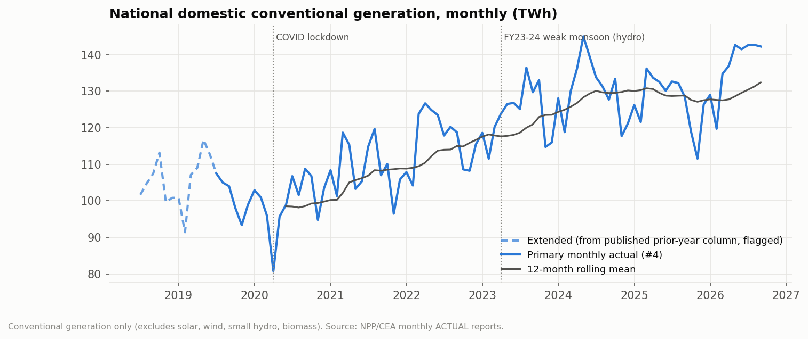
*01_national_monthly.png: Monthly domestic conventional generation with 12-month rolling mean; dashed = flagged extension 2018-07..2019-06.*

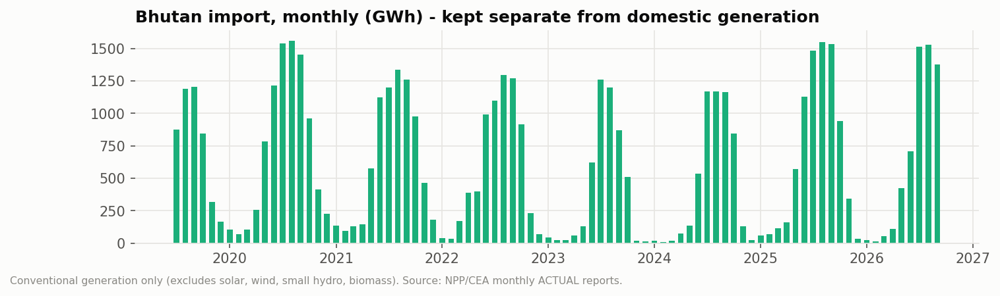
*02_bhutan_import_monthly.png: Bhutan hydro import: strongly monsoonal, separate series.*

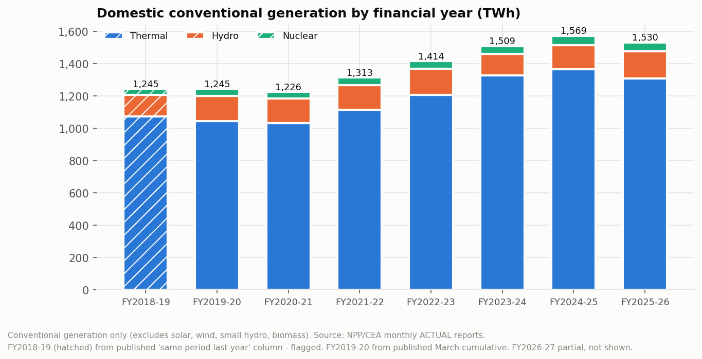
*03_fy_national_by_category.png: FY totals by category.*

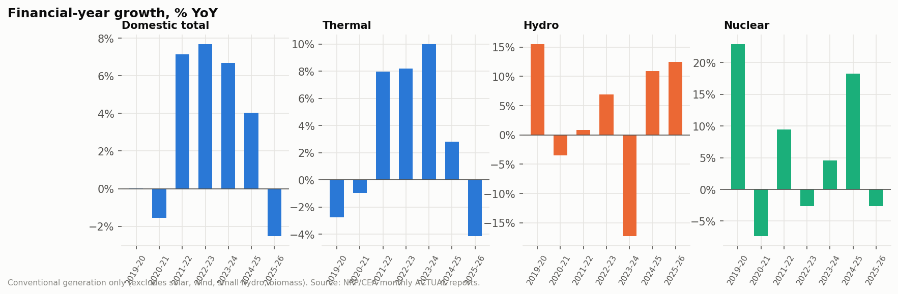
*04_fy_yoy_growth.png: FY YoY growth: total and by category (independent y-scales per panel).*

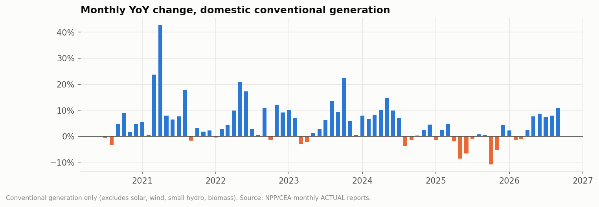
*05_monthly_yoy.png: Monthly YoY; COVID base effects in 2020-21 dominate.*

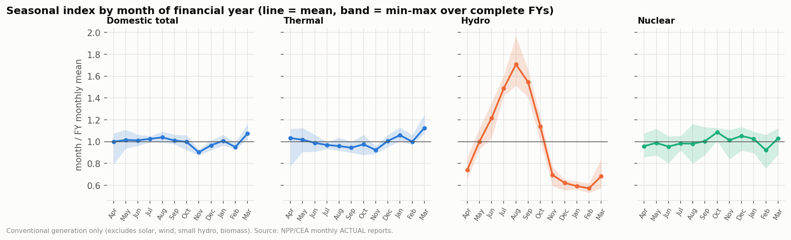
*06_seasonality.png: Seasonal indices: hydro peaks Jul-Sep (monsoon), thermal peaks pre-monsoon/Mar-May and dips in monsoon.*

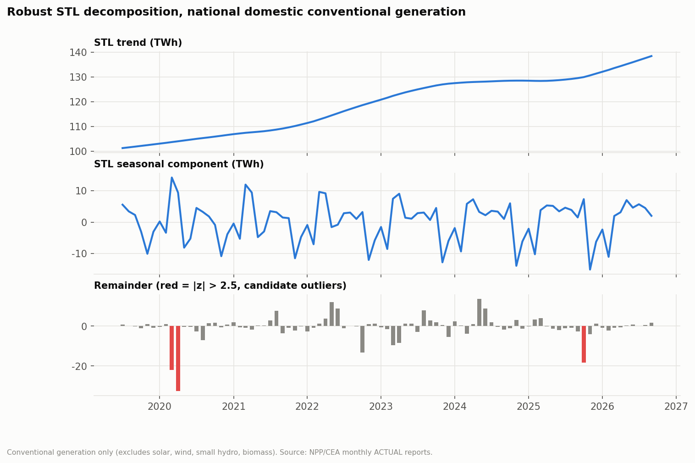
*07_stl_decomposition.png: STL trend/seasonal/remainder and outlier months.*

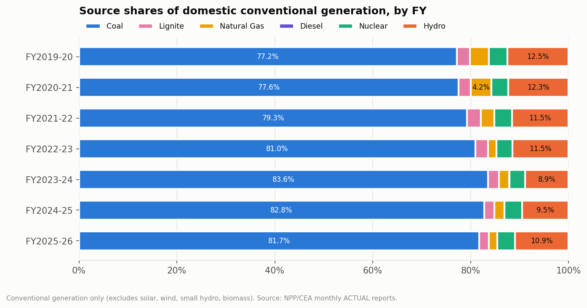
*08_source_shares.png: Source shares within conventional generation.*

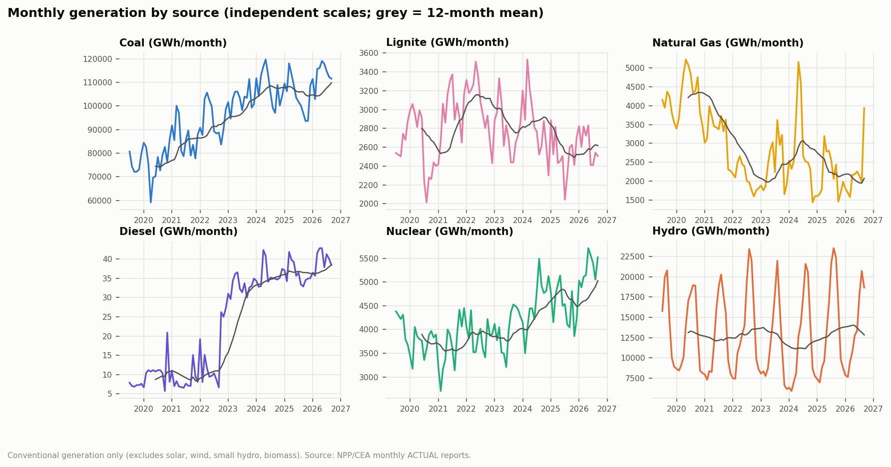
*09_source_monthly.png: Monthly series by source.*

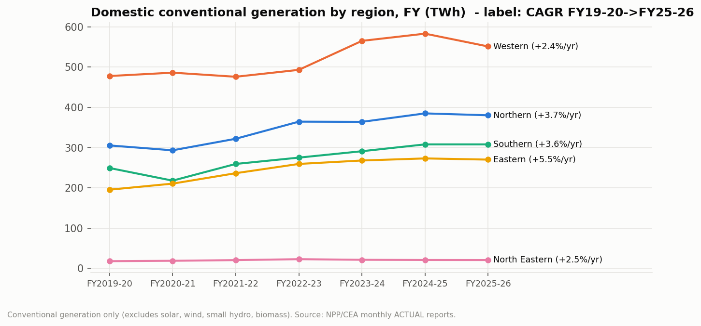
*10_regional_fy.png: Regional FY totals and CAGR.*

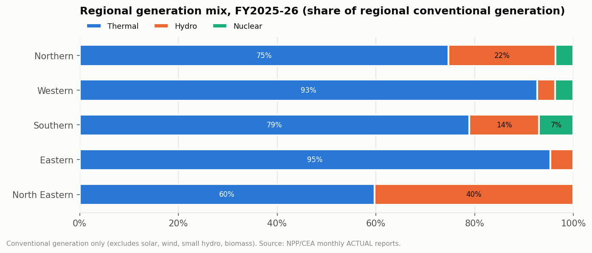
*11_regional_mix.png: Regional category mix FY2025-26.*

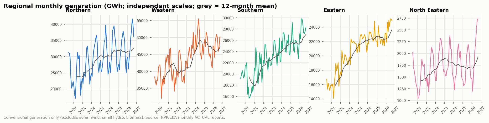
*12_regional_monthly.png: Regional monthly series.*

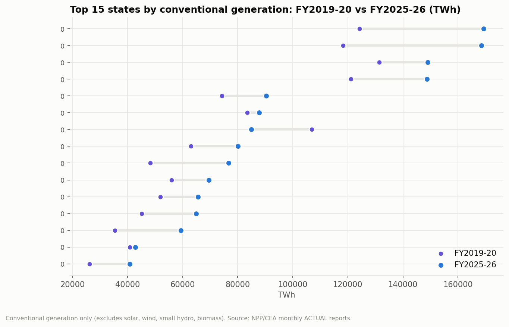
*13_state_top15.png: Largest generating states, change over six years.*

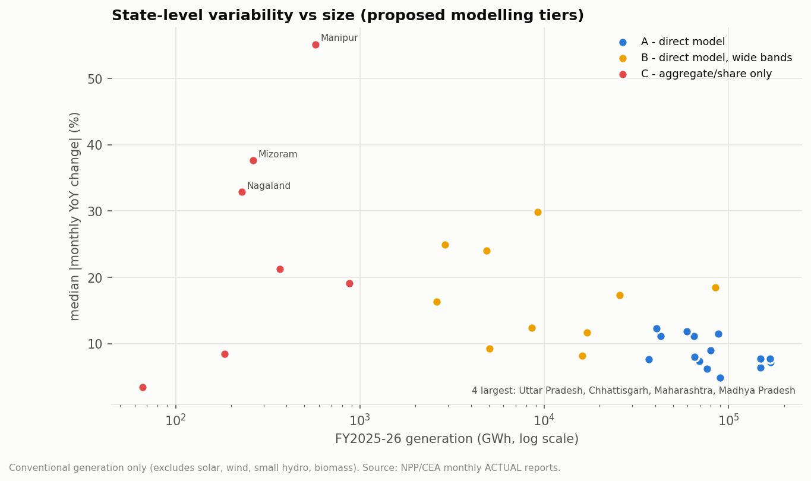
*14_state_variability.png: Small states are far more volatile -> tiered modelling.*

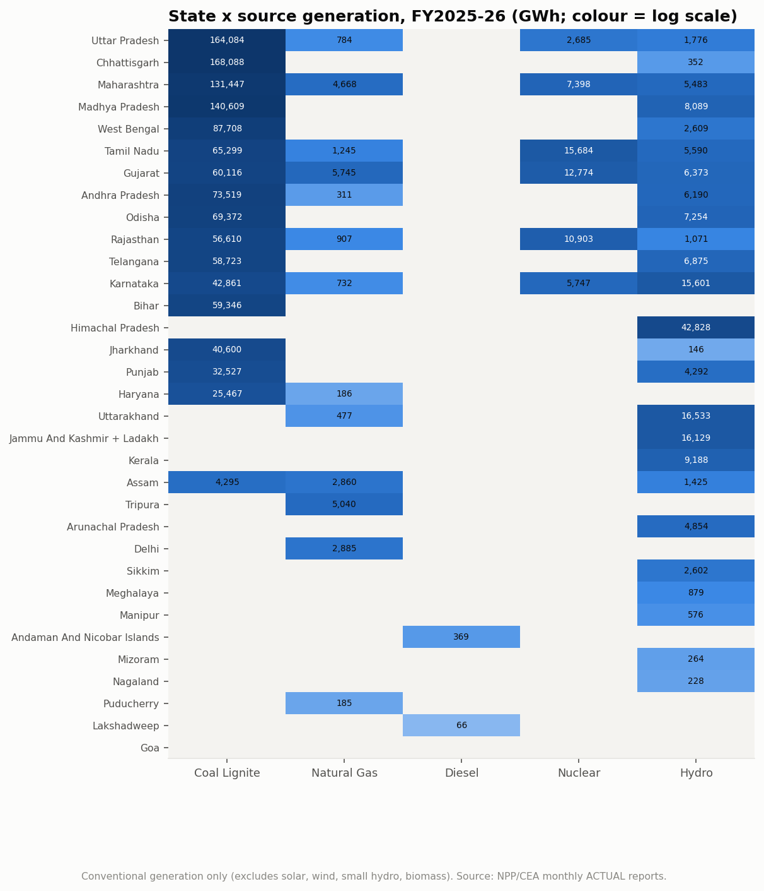
*15_state_source_heatmap.png: Which sources exist in which states (zero = blank).*

